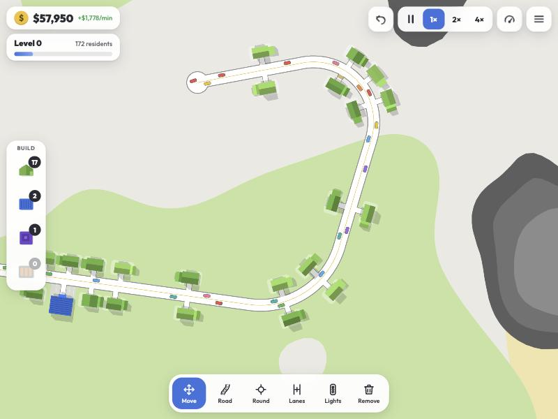
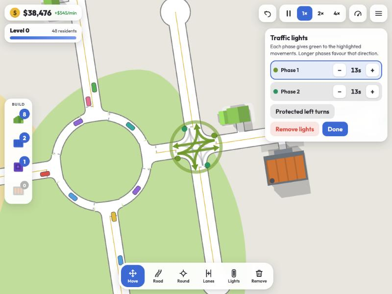
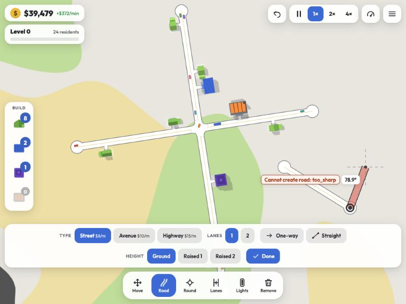
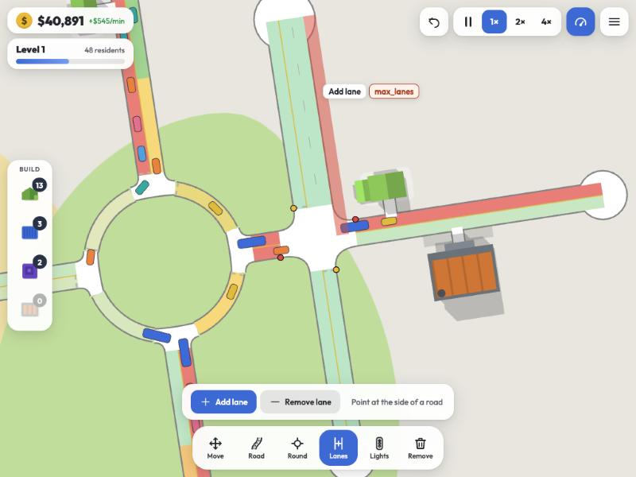
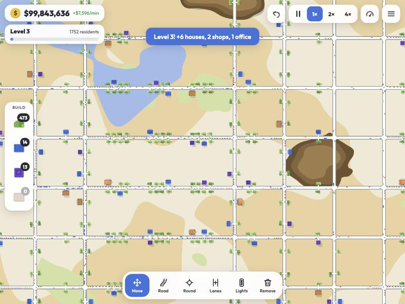
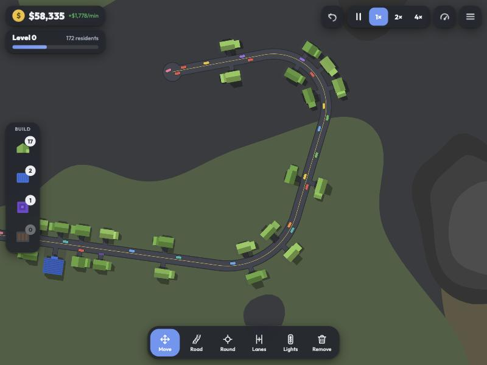

# One More Lane

A tiny, top-down, **gridless road-building traffic game** for the browser, built with [Three.js](https://threejs.org).
Draw smooth roads at any angle, fix jams with roundabouts, traffic lights and overpasses, and keep a growing city moving.

It is an installable **PWA** (works offline), plays with a **mouse on desktop** and with **fingers on a tablet**, and deploys as
plain static files to **GitHub Pages**.

**Play it: <https://thomasbrueggemann.github.io/one-more-lane/>** (Chrome/Edge: *Install* in the menu or address bar; iPad/iPhone: *Share → Add to Home Screen*).

| | |
| --- | --- |
|  |  |
|  |  |
|  |  |

> Inspired by the trailer of *Trafficity* by Onramp Games. This is an independent, from-scratch project: no assets, code or
> branding from that game are used.

## Playing

| Tool | What it does |
| --- | --- |
| **Move** | Pan with one finger / the mouse. Tap a building for info or to pick it up. |
| **Road** | Drag (or tap two points) to build. Continue from a road end and it bends smoothly. Snaps to junctions, road sides and to parallel/perpendicular/axis guides. Choose Street / Avenue / Highway, lanes, one-way and height (Raised 1/2 = overpass and ramps). |
| **Round** | Tap a junction or open ground for a roundabout, drag to set its size. |
| **Lanes** | Point at the side of a road to add (or remove) a lane. |
| **Lights** | Tap a junction to install traffic lights, tap again to edit them: phase durations (lights are actuated, so a green ends early when nobody is waiting), protected left turns, and tap any arrow on the map to move that movement into the selected phase. |
| **Remove** | Tap or drag over roads and buildings (half the money back; buildings return to the tray). |
| **Build tray** | Tap a building type, then tap next to a street; drag along a road to place a row. |

Residents drive to work and to the shops (and trucks deliver goods) using routes that adapt to current traffic. Smooth trips
fill the level bar; every level brings a new batch of buildings and a cash bonus. Red badges show buildings that are not
connected to a road, orange ones show unhappy residents stuck in traffic. The gauge button shows a congestion heat-map.

Pick **Free play** on the New city screen to build without money limits: nothing costs anything and the HUD shows ∞ instead of a
balance. Levels and the building tray still progress as usual.

* **Mouse:** left-drag uses the tool, right/middle-drag pans, wheel zooms. Keys: `1`–`6` tools, `Space` pause, `Ctrl+Z` undo, `Ctrl+S` save, `T` traffic view, `Esc` cancel, WASD/arrows pan.
* **Touch:** one finger uses the tool, two fingers pan and pinch to zoom. Building ghosts float above your fingertip so you can see them.
* **Saving:** your city is autosaved to the browser every 20 seconds (start screen: *Continue*). For saves you control, open the menu and
  choose *Save game* (three slots, or `Ctrl/Cmd+S` to save again to the same slot); *Load game* on the menu and the start screen lists
  the autosave and the slots with level, map, size and age. Saves live in this browser's localStorage only (`one-more-lane-*` keys).

## Run it locally

No build step. Any static server works:

```bash
npm start            # http://localhost:5173  (node tools/serve.mjs [port] [directory])
npm test             # headless unit, simulation, signal, planner, fuzz, regression and whole-game tests (Node 20+)
```

The game logic (road graph, planner, traffic simulation, city) is DOM-free, so it also runs headless. Handy scripts:

```bash
node tests/capacity.mjs       # junction throughput under saturation: all-way stop vs lights vs roundabout
node tests/perf.mjs           # cost of a sim step with ~1,100 vehicles on a 240-edge network
node tests/terrain-stats.mjs  # share of water / rock / grass / sand per biome
```

The service worker is disabled on `localhost` (cache-first workers confuse development). Add `?pwa` to the URL
(`http://localhost:5173/?pwa`) to test installation and offline mode.

## Deploy to GitHub Pages

1. Create a repository (it has to be public unless your GitHub plan includes Pages for private repositories) and push this folder to its `main` branch:
   ```bash
   git init && git add . && git commit -m "One More Lane"
   git branch -M main
   git remote add origin git@github.com:<you>/<repo>.git
   git push -u origin main
   ```
2. In the repository open **Settings → Pages → Build and deployment → Source: GitHub Actions**.
3. The included workflow (`.github/workflows/pages.yml`) runs the tests, stamps the service worker with a fresh cache
   version and file list (`node tools/build-sw.mjs`) and publishes the site. It will be live at
   `https://<you>.github.io/<repo>/`.

Everything uses relative URLs, so it works from a sub-path. If you prefer *Deploy from a branch*, point Pages at the root of
`main`; the committed `sw.js` already contains a valid precache list (re-run `npm run build:sw` after changing files).

**Installing:** Chrome/Edge show an *Install* button in the menu (or the address bar); on iPad/iPhone use *Share → Add to Home
Screen*. Once installed it runs fullscreen and offline.

## Project layout

```
index.html, css/            app shell and styles (Outfit font is bundled)
manifest.webmanifest, sw.js PWA manifest and service worker (stamped by tools/build-sw.mjs)
icons/                      generated by `npm run icons` (tools/make-icons.mjs, dependency-free)
vendor/                     Three.js r186 (minified ES modules, MIT)
js/
  util.js geom.js           math, noise, polylines, arcs, intersections
  terrain.js                procedural biomes (water / rock / grass / sand fields)
  network.js                road graph, rounded junction geometry, lanes, connections, conflicts
  roadplan.js               plan → validate → apply: roads, ramps, roundabouts, lanes, signals, bulldozing
  router.js sim.js signals.js
                            congestion-aware A*, microscopic traffic (IDM, junction control, lane changes), signal phases
  buildings.js city.js      building shapes, placement rules, trips, economy, levels
  game.js                   ties it together; undo and save/load; headless-friendly
  render/                   Three.js renderers (terrain shader, roads, buildings, vehicles, overlays)
  tools.js input.js ui.js app.js main.js
                            tools, pointer/touch gestures, DOM UI, app shell
tests/                      node:test scripts (geometry, network, planner, signals, simulation, fuzz, whole game, regressions) + benchmarks
docs/                       screenshots used in this README
```

To rename the game, edit `js/config.js`, `manifest.webmanifest` and the title/meta tags in `index.html`
(optionally the `one-more-lane-` cache prefix in `sw.js` and `tools/build-sw.mjs`).

## Credits

[Three.js](https://threejs.org) (MIT) and the [Outfit](https://github.com/Outfitio/Outfit-Fonts) typeface (SIL OFL 1.1)
are vendored with their licences in `vendor/` and `fonts/`.
